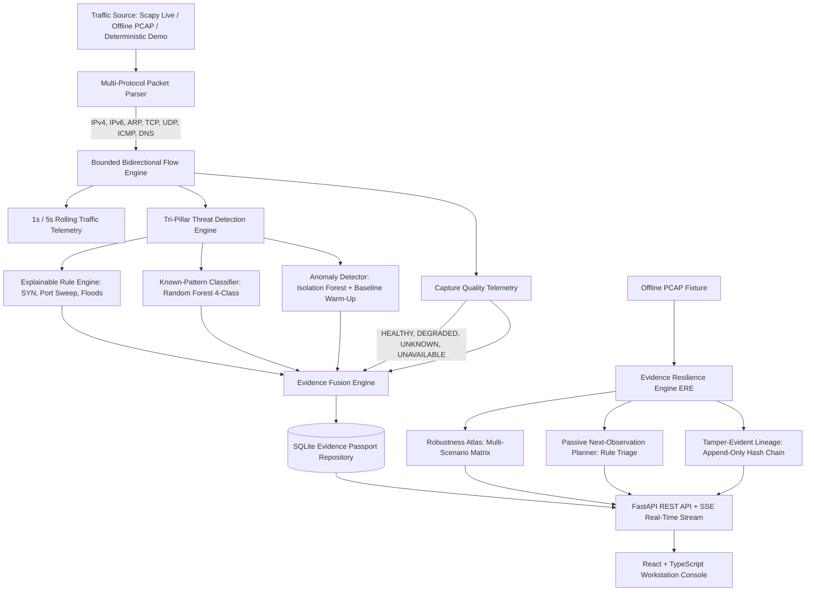

# NetGuard: Evidence-Aware Network Threat Observatory
### With Evidence Resilience Engine (ERE) & Offline Evidence Resilience Studio

[](https://www.python.org/)
[](https://fastapi.tiangolo.com/)
[](https://react.dev/)
[](https://www.typescriptlang.org/)
[](#7-automated-test-suite)
[](#8-ethics-privacy--safety-boundaries)

---

## 1. Research Mission & Novelty Contribution

NetGuard is an **advisory, read-only Network Threat Observatory** designed for computer network security analysis, flow monitoring, and research into detection robustness under real-world observation failures.

Standard Network Intrusion Detection Systems (NIDS) report categorical threat labels while assuming perfect, lossless observation. In reality, monitors drop packets due to kernel queue saturation, NIC ring-buffer exhaustion, or asymmetric routing (*Computer Communications*, 2026).

NetGuard introduces the **Evidence Resilience Engine (ERE)**, uniting three tightly coupled capabilities into a cohesive investigation workflow:

1. **Observation Robustness Atlas:** Systematically measures how incident decisions change under a reproducible matrix of controlled observation failures (Random Loss across seed ensembles, Burst Loss, and Directional Visibility Loss), with exact packet accounting (Source, Omitted, Retained) and canonical `(source, timestamp)` time-window alignment.
2. **Passive Next-Observation Planner:** Converts observed telemetry gaps (e.g., unavailable kernel counters, queue drops, directional flips) into a ranked, explainable list of additional passive observations or checks that reduce investigative uncertainty, without transmitting network packets or taking active actions (`active_network_action: false`).
3. **Tamper-Evident Evidence Lineage:** Cryptographic provenance tracking linking the original incident, source-capture fingerprint, parser/feature/model configuration, and robustness experiment through RFC 8785 canonical JSON manifests and an append-only SQLite SHA-256 hash chain with genesis block linkage.

### Academic Honesty & Scope Guarantees
- **No Pretend Live Capture:** Offline/synthetic sessions are visibly labeled `DEMO / SYNTHETIC`. Synthetic traffic is never disguised as live enterprise capture.
- **Strictly Advisory & Read-Only:** NetGuard never transmits packets, attacks remote endpoints, injects firewall rules, or automatically blocks IP addresses.
- **The Non-Mutation Guarantee:** Robustness sweeps and planner outputs append child findings. They **never mutate, rewrite, suppress, or delete** original incident records in the Evidence Passport repository.
- **Honest Capture Telemetry:** Missing OS/driver statistics are represented as `UNKNOWN` or `UNAVAILABLE`—never faked as "0% packet loss".
- **Bounded Stability Claims:** Decisions are reported as "Stable within tested parameter space"—never as universal zero-day guarantees.

---

## 2. System Architecture



---

## 3. Quickstart & Installation

### 3.1 Prerequisites
- **Python 3.10+**
- **Node.js 18+** and **npm**
- Windows (PowerShell), Linux, or macOS. *No elevated privileges, special capture drivers, or cloud API keys are required.*

### 3.2 Backend Setup
```powershell
# 1. Clone repository and navigate to directory
cd "NetGuard-main"

# 2. Activate virtual environment
.\.venv\Scripts\Activate.ps1

# 3. Install backend dependencies (if needed)
python -m pip install -r backend/requirements.txt
```

### 3.3 Frontend Compilation
```powershell
cd frontend
npm install
npm run build
cd ..
```

---

## 4. Running the Observatory

### Option A: Complete Web Observatory (Recommended)
Launch the unified FastAPI server hosting both the REST API and the compiled React workstation console on port 8000:

```powershell
.\.venv\Scripts\python.exe -m backend.main --server --host 127.0.0.1 --port 8000
```
Open **`http://localhost:8000`** in any modern web browser.

### Option B: Generating Research Evidence Artifacts
Execute the automated ERE research runner to run a 25-scenario sweep, generate passive triage recommendations, verify the hash chain, and export reproducible JSON bundles into `artifacts/research/`:

```powershell
.\.venv\Scripts\python.exe -m backend.scripts.generate_research_evidence
```

---

## 5. Web Console Surfaces & Evidence Resilience Studio

| Navigation Area | Description |
|---|---|
| **Overview** | Real-time packets/sec, bytes/sec, active hosts/flows, protocol distribution (TCP/UDP/ICMP/ARP/DNS), recent incident feed, and capture quality status. |
| **Flows & Traffic** | Bounded bidirectional flow table (5-tuples), directional packet/byte accounting, duration, observed TCP flags, and pagination. |
| **Host Explorer** | Interactive SVG-rendered communication relationship graph with host inspection drawers. |
| **Alerts & Evidence** | Searchable incidents with the **Evidence Passport**: explainable rule triggers, uncalibrated classifier score, anomaly baseline readiness, and non-destructive investigation steps. |
| **Replay Lab / Evidence Resilience Studio** | Four specialized sub-surfaces:<br>• **Single Replay:** Baseline vs. single perturbation comparison.<br>• **Robustness Atlas:** Sweep matrix builder, heatmap table, instability boundary, and feature drift.<br>• **Next Observation:** Ranked, explainable passive triage recommendations citing real telemetry gaps (`active_network_action: false`).<br>• **Evidence Lineage:** Cryptographic hash-chain verifier (`VALID`/`INVALID`), manifest inspector, and one-click JSON Evidence Bundle export. |
| **Model Evaluation** | Held-out test evaluation report: per-class Precision/Recall/F1, Macro-F1, confusion matrix, false alerts per benign hour, detection latency, and throughput. |
| **Settings & Reports** | Download full Evidence Passports as JSON or CSV. Includes one-click **IP Address Pseudonymization** for privacy compliance. |

---

## 6. Additive ERE / Lens API Surface

All new research capabilities are exposed through dedicated, typed, backwards-compatible endpoints under `/api/lens/`:

- `POST /api/lens/robustness-runs` — Create bounded sweep run with safe PCAP ID, loss profiles, and seeds.
- `GET /api/lens/robustness-runs` — List all recent sweep runs and execution statuses.
- `GET /api/lens/robustness-runs/{run_id}` — Inspect sweep progress, atlas matrix, and robustness envelope.
- `POST /api/lens/robustness-runs/{run_id}/cancel` — Gracefully request cancellation of an active sweep.
- `GET /api/lens/robustness-runs/{run_id}/report` — Retrieve reproducible JSON robustness report.
- `GET /api/lens/alerts/{alert_id}/observation-plan` — Generate explainable passive follow-up plan for an incident.
- `GET /api/lens/lineage/verify` — Independently recompute and verify SQLite evidence hash chain.
- `GET /api/lens/lineage/events` — Paginated list of append-only lineage manifests.
- `GET /api/lens/lineage/{event_id}` — Retrieve full canonical JSON manifest for an event block.
- `GET /api/lens/evidence-bundle/{id}` — Download reproducible Evidence Bundle uniting incident, sweep, and lineage.

---

## 7. Automated Test Suite

Run the complete regression suite covering packet parsing, flow tracking, capture quality, threat detection, PCAP path isolation, sweep matrix orchestration, planner determinism, and hash-chain tamper detection:

```powershell
.\.venv\Scripts\python.exe -m pytest -v
```

**Results:** `77 passed, 2 skipped, 0 failed` in 9.17 seconds. (Skipped tests are optional held-out tests that require training model artifacts).

---

## 8. Ethics, Privacy & Safety Boundaries

- **Passive & Advisory:** NetGuard transmits zero packets and performs no active port scanning, ping sweeps, or automated host blocking.
- **Metadata Only:** Payloads are never captured, examined, or stored. Only packet headers, flow statistics, and DNS query names/types are processed.
- **Privacy Controls:** Host IP addresses can be pseudonymized in all generated incident reports and exported bundles.
- **Safe Path Resolution:** PCAP access is strictly constrained to authorized allowlisted project directories, rejecting directory traversal sequences (`..`), non-pcap extensions, and paths outside allowed roots.
- **Tamper Evidence:** SHA-256 hash chains detect in-place modification of recorded incidents and experiments within application storage; they do not represent global blockchain infrastructure or protection against hostile disk destruction.
