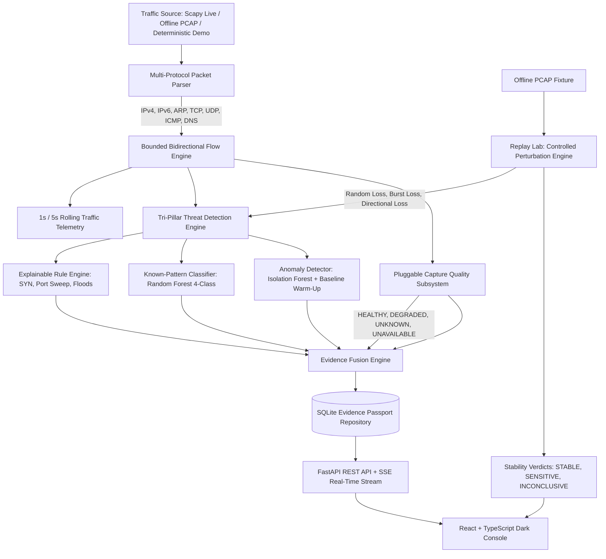

# NetGuard: Evidence-Aware Network Threat Observatory
### With Capture-Aware Incident Verification & Offline Replay Lab

[](https://www.python.org/)
[](https://fastapi.tiangolo.com/)
[](https://react.dev/)
[](https://www.typescriptlang.org/)
[](#ethics-and-safety-boundaries)

---

## 1. Mission & Research Differentiator

NetGuard is an **advisory, read-only Network Threat Observatory** designed for computer network security analysis, flow monitoring, and research into detection robustness.

Standard Network Intrusion Detection Systems (NIDS) report categorical threat labels while assuming perfect, lossless observation. In reality, monitors drop packets due to kernel queue saturation, NIC ring-buffer exhaustion, or asymmetric routing.

NetGuard introduces **Capture-Aware Incident Verification**:
> When NetGuard raises a suspicious-traffic alert, it presents the raw network evidence behind the finding, evaluates the quality/limitations of the capture handle, and provides an offline **Replay Lab** to test whether the classification holds when the exact same capture is reprocessed under controlled, explicitly hypothetical packet-observation-loss scenarios.

### Academic Honesty & Scope Guarantees
- **No Pretend Live Capture:** Offline/synthetic sessions are visibly labeled `DEMO / SYNTHETIC`. Synthetic traffic is never disguised as live enterprise capture.
- **Strictly Advisory & Read-Only:** NetGuard never transmits packets, attacks remote endpoints, injects firewall rules, or automatically blocks IP addresses.
- **The Non-Mutation Guarantee:** Counterfactual sensitivity findings in the Replay Lab are advisory and recorded alongside the incident. They **never mutate, delete, or downgrade** the original alert.
- **Honest Capture Telemetry:** Missing OS/driver statistics are represented as `UNKNOWN` or `UNAVAILABLE`—never faked as "0% packet loss".
- **Zero Fabricated Benchmark Numbers:** If model evaluation has not been executed on held-out test data, the system displays `Not evaluated yet`.

---

## 2. System Architecture



---

## 3. Quickstart & Installation

### 3.1 Prerequisites
- **Python 3.10+**
- **Node.js 18+** and **npm** (for web console compilation)
- Windows (PowerShell), Linux, or macOS. *No elevated privileges, special capture drivers, or cloud API keys are required to run the full application and demo.*

### 3.2 Backend Setup
```powershell
# 1. Clone repository and navigate to directory
cd "NetGuard-main"

# 2. Create and activate virtual environment
python -m venv .venv
# Windows PowerShell:
.venv\Scripts\Activate.ps1
# Linux/macOS:
# source .venv/bin/activate

# 3. Install backend dependencies
python -m pip install -r backend/requirements.txt
```

### 3.3 Frontend Setup (Single Build)
```powershell
# Navigate to frontend and compile production bundle
cd frontend
npm install
npm run build
cd ..
```

---

## 4. Running the Observatory

### Option A: Complete Web Observatory (Recommended)
Launch the unified FastAPI server. Because the frontend is compiled into `frontend/dist/`, the server hosts both the typed REST API and the interactive React console on a single port:

```powershell
.venv\Scripts\python.exe -m backend.main --server --host 127.0.0.1 --port 8000
```
Open **`http://localhost:8000`** in any modern web browser.
- Automatically launches in deterministic demo mode.
- Streams live traffic metrics, flow records, and incidents over Server-Sent Events (SSE).
- Provides immediate access to Flow Analysis, Host Explorer, Evidence Passports, and Replay Lab.

### Option B: Frontend Hot-Reload Development
If you wish to edit the React frontend with Vite instant hot-reloading:
```powershell
# Terminal 1: Backend API
.venv\Scripts\python.exe -m backend.main --server

# Terminal 2: Vite Dev Server
cd frontend
npm run dev
```
Navigate to `http://localhost:5173`.

### Option C: Preserved Terminal CLI Workflows
The original command-line interface remains fully supported:
```powershell
# List available network capture adapters
.venv\Scripts\python.exe -m backend.main --list-interfaces

# Run terminal monitoring on a live interface (requires OS capture permissions)
.venv\Scripts\python.exe -m backend.main --interface "Ethernet"

# Replay an offline PCAP directly in the terminal
.venv\Scripts\python.exe -m backend.main --pcap "artifacts/demo/test-SYN_FLOOD-0.pcap"

# Replay with model predictions and JSONL export
.venv\Scripts\python.exe -m backend.main --pcap "artifacts/demo/test-PORT_SCAN-0.pcap" --model "artifacts/demo/model.joblib" --predictions "artifacts/scan.jsonl"
```

---

## 5. Web Console Features

| Page | Description |
|---|---|
| **Overview** | Real-time packets/sec, bytes/sec, active hosts/flows, protocol distribution (TCP/UDP/ICMP/ARP/DNS), recent incident feed, and capture quality status. |
| **Flows & Traffic** | Bounded bidirectional flow table (5-tuples), directional packet/byte accounting, duration, observed TCP flags, and pagination. |
| **Host Explorer** | Interactive SVG-rendered communication relationship graph. Warns that it represents observed flows rather than physical switch topology. |
| **Alerts & Evidence** | Searchable incidents with the **Evidence Passport**: explainable rule triggers, uncalibrated classifier score, anomaly baseline readiness, and non-destructive investigation steps. |
| **Replay Lab** | Counterfactual offline PCAP verification. Compare baseline vs. 5%–50% loss under Random, Burst, or Directional perturbation profiles. Inspect feature shifts and stability verdicts. |
| **Model Evaluation** | Rigorous held-out test evaluation report: per-class Precision/Recall/F1, Macro-F1, confusion matrix, false alerts per benign hour, detection latency, and throughput. |
| **Settings & Reports** | Download full Evidence Passports as JSON or CSV. Includes one-click **IP Address Pseudonymization** for privacy compliance. |

---

## 6. Training & Research Evaluation

NetGuard uses session-separated splits (`train`, `validation`, `test`) to prevent data leakage across rolling time windows:

```powershell
# 1. Generate deterministic synthetic demo PCAPs (if needed)
.venv\Scripts\python.exe -m backend.ml demo-data --directory artifacts/demo --sessions 4

# 2. Train Random Forest model and evaluate on held-out test sessions across 0%, 10%, 30% loss
.venv\Scripts\python.exe -m backend.ml train --manifest artifacts/demo/manifest.json --model artifacts/demo/model.joblib
```

The resulting verified evaluation report is saved to `artifacts/demo/model.report.json` and automatically surfaced in the web console's **Model Evaluation** tab.

---

## 7. Automated Test Suite

Run the full automated test suite covering parser logic, flow aggregation, capture quality, threat detection, anomaly scoring, Replay Lab reproducibility, and SQLite persistence:

```powershell
.venv\Scripts\pytest.exe -v
```

All 54 unit, integration, and regression test suites run offline without live capture hardware or administrative permissions.

---

## 8. Ethics, Privacy & Safety Boundaries

- **Passive & Advisory:** NetGuard does not emit traffic, alter routing tables, or execute automated packet dropping.
- **Metadata Only:** Payloads are never captured, examined, or stored by default. Only packet headers, flow statistics, and DNS query names/types are processed.
- **Privacy Controls:** Host IP addresses can be pseudonymized in all generated incident reports and exports.
- **Loopback Enforcement:** The web management API binds to `127.0.0.1` by default to prevent unauthorized network exposure.
- **Explicit Authorized Scope:** Live capture must be performed solely on networks and interfaces for which the operator has explicit authorization.
