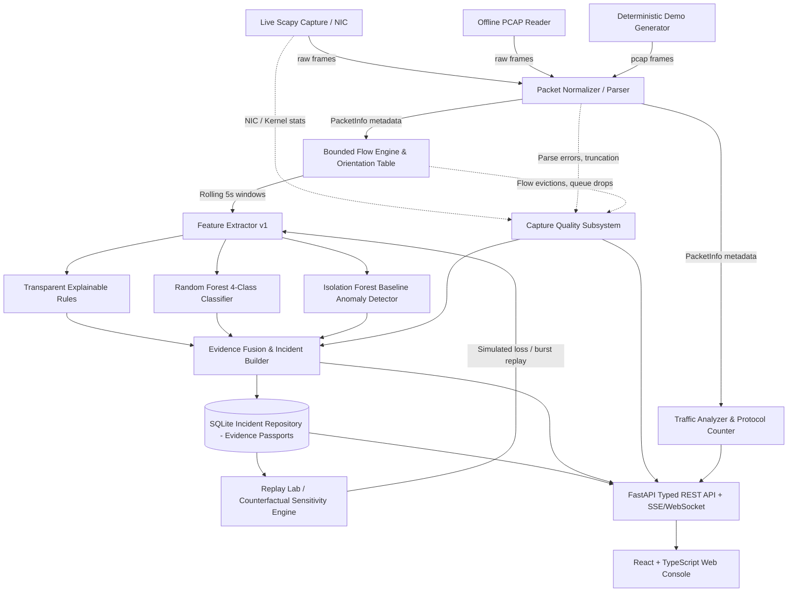

# NetGuard Architecture & System Design
**Evidence-Aware Network Threat Observatory with Capture-Aware Incident Verification**

## 1. System Overview & Core Philosophy
NetGuard is an advisory, read-only network observability and intrusion analysis platform. It inspects packet metadata without inspecting or persisting application payloads, computes bidirectional flow metrics, detects attack patterns using both transparent rules and machine learning, and performs **Capture-Aware Incident Verification (Counterfactual Observation-Loss Sensitivity)**.

### Non-Negotiable Tenets:
1. **Advisory & Read-Only**: NetGuard does not block traffic, alter routing tables, or transmit active counter-attack packets.
2. **Deterministic & Honest**: Synthetic or simulated data is visibly labeled `DEMO / SYNTHETIC`. Live traffic is only captured on authorized local interfaces. Missing counters are represented as `UNKNOWN` or `UNAVAILABLE`, never assumed to be zero.
3. **Separation of Threat Risk from Evidence Completeness**: Detector confidence/decisions are kept distinct from telemetry observation quality. Low quality downgrades an alert to `UNCERTAIN` or flags it as needing review, but never magically converts suspicious findings to benign.
4. **Counterfactual Non-Mutation**: Running hypothetical packet-loss or completion experiments provides sensitivity analysis; it never alters or rewrites the original incident record.

---

## 2. Component Pipeline & Data Flow

---

## 3. Module Boundaries & Responsibilities

### Backend Modules:
- `backend/models/packet.py`: Immutable packet metadata dataclass (`PacketInfo`).
- `backend/analyzer/packet_parser.py`: Scapy frame normalization for IPv4, IPv6, ARP, ICMP/ICMPv6, TCP/UDP, and DNS metadata.
- `backend/analyzer/traffic_analyzer.py`: Rolling and cumulative packet/byte counters, protocol distributions, and sliding window rates.
- `backend/analyzer/flow_engine.py`: Bidirectional 5-tuple flow aggregation, directional byte/packet accounting, TCP flag/handshake state tracking, and host communication graphs.
- `backend/capture/packet_capture.py`: Non-blocking AsyncSniffer integration, interface enumeration, safe shutdown, and BPF filtering.
- `backend/services/capture_quality.py`: Pluggable telemetry assessor reporting `HEALTHY`, `DEGRADED`, `UNKNOWN`, and `UNAVAILABLE` states for OS drops, queue drops, and evictions.
- `backend/ml/features.py`: Standardized 12-feature sliding window extractor (`netguard-source-window-v1`).
- `backend/ml/detector.py`: Random Forest scoring, baseline deterministic rules, and confidence assessment.
- `backend/ml/anomaly.py`: Isolation Forest anomaly detector with benign warm-up baseline and poison protection.
- `backend/ml/fragility.py`: Handshake pair sensitivity checker (counterfactual completion).
- `backend/ml/replay.py`: Deterministic offline PCAP replay supporting seedable random loss, burst loss, and directional omission.
- `backend/ml/train.py` & `demo.py`: Session-separated training, validation threshold selection, and synthetic test PCAP generator.
- `backend/storage/repository.py`: Thread-safe SQLite persistence for Evidence Passports, flow records, and replay experiments.
- `backend/api/`: FastAPI routers for health, overview, flows, hosts, alerts, replay experiments, model evaluations, and Server-Sent Events / WebSockets.
- `backend/main.py`: Unified entry point supporting both classic CLI monitor and web service server modes.

### Frontend Application (`frontend/`):
- React 18, TypeScript, Vite.
- Dark restrained slate/graphite aesthetic with cyan/blue accents and research tags.
- Modules:
  - **Overview**: System state, throughput charts, protocol breakdown, and capture quality badges.
  - **Live Traffic / Flows**: Real-time paginated flow table, directional counters, filters, and export.
  - **Host Explorer**: Observed communication network graph, talker metrics, and host drill-down.
  - **Alerts & Evidence Passport**: Deep-dive incident inspection, rule triggers, ML scores, anomaly signals, capture quality caveats, and safe next-steps.
  - **Replay Lab**: Interactive counterfactual perturbation experiments (baseline vs random/burst loss).
  - **Model Evaluation**: Transparent metrics (precision, recall, macro-F1, confusion matrix, false alerts per hour) or explicit `Not evaluated` states.
  - **Reports & Settings**: Incident export, IP pseudonymization toggles, interface selection.

---

## 4. Security, Privacy & Safety Defaults
- **Loopback Default**: API binds to `127.0.0.1` by default; CORS restricted to local frontend origin.
- **Payload-Free**: No packet payloads stored or parsed into application strings.
- **Input Sanitization**: Replay PCAP files are constrained to trusted sandbox folders with server-side validation; arbitrary filesystem access is blocked.
- **Safe Serialization**: Trained models loaded only from local trusted configurations; no unauthenticated model uploads.
